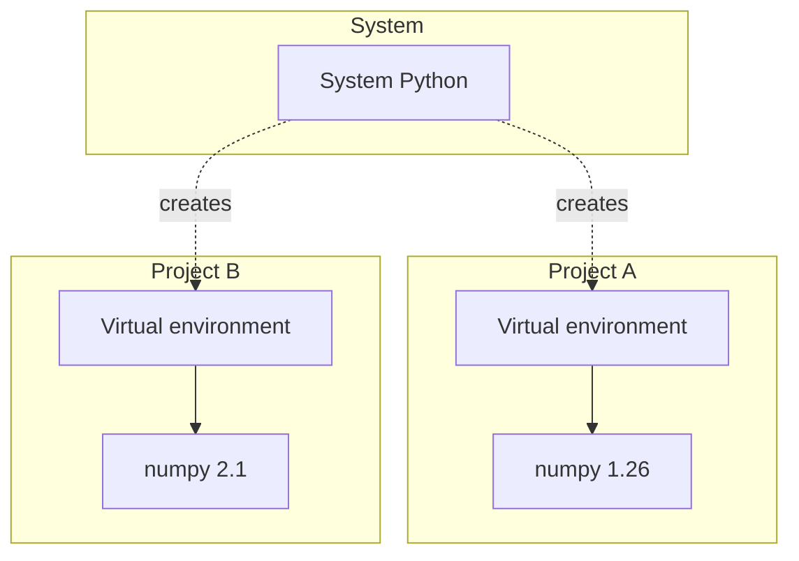

# Python: Environments & Dependency Management

### Filippo Poltronieri <filippo.poltronieri@unife.it>
## Table of contents

- [1. Introduction](#1-introduction)
	- [1.1. The problem](#11-the-problem)
	- [1.2. Virtual environments](#12-virtual-environments)
	- [1.3. The Python packaging ecosystem](#13-the-python-packaging-ecosystem)
	- [1.4. pip](#14-pip)
- [2. The standard toolchain: venv and pip](#2-the-standard-toolchain-venv-and-pip)
	- [2.1. Creating a virtual environment](#21-creating-a-virtual-environment)
	- [2.2. Activating and deactivating](#22-activating-and-deactivating)
	- [2.3. Installing packages](#23-installing-packages)
	- [2.4. Freezing dependencies](#24-freezing-dependencies)
	- [2.5. Limitations](#25-limitations)
- [3. uv](#3-uv)
	- [3.1. What is uv](#31-what-is-uv)
	- [3.2. Installing uv](#32-installing-uv)
	- [3.3. Managing Python versions](#33-managing-python-versions)
	- [3.4. Projects and pyproject.toml](#34-projects-and-pyprojecttoml)
	- [3.5. Adding and removing dependencies](#35-adding-and-removing-dependencies)
	- [3.6. Lockfiles and reproducibility](#36-lockfiles-and-reproducibility)
	- [3.7. Running code](#37-running-code)
	- [3.8. Development dependencies](#38-development-dependencies)
	- [3.9. Migrating from requirements.txt](#39-migrating-from-requirementstxt)
	- [3.10. Running one-off tools](#310-running-one-off-tools)
	- [3.11. Editor integration](#311-editor-integration)
- [4. Other tools](#4-other-tools)
	- [4.1. conda](#41-conda)
	- [4.2. Choosing a tool](#42-choosing-a-tool)
- [Glossary](#glossary)
- [Bibliography](#bibliography)
- [Licenses](#licenses)

## 1. Introduction

### 1.1. The problem

Real programs depend on code written by other people, distributed as **packages**, e.g. **pandas** or **numpy**.

Two projects on the same machine may need:
- Different versions of the same package (e.g., project A needs `numpy 1.x`, project B needs `numpy 2.x`).
- Different versions of Python itself.

Installing everything **globally**, system-wide:
- Causes version conflicts between projects.
- Makes it hard to reproduce a working setup on another machine ("it works on my machine").
- Can break tools that the operating system itself relies on.

---

On Ubuntu 24.04 (the reference OS for this course, see [§1.6](python-basic-stuff-pt1.md#16-development-environment)), `pip` refuses to do this at all:

```shell
$ pip install requests
error: externally-managed-environment

× This environment is externally managed
╰─> To install Python packages system-wide, try apt install
    python3-xyz, where xyz is the package you are trying to
    install.

    If you wish to install a non-Debian-packaged Python package,
    create a virtual environment using python3 -m venv path/to/venv.

hint: See PEP 668 for the detailed specification
```

This is not a bug: the OS is protecting its own Python installation from being broken by unrelated packages.

### 1.2. Virtual environments

**A virtual environment is an isolated Python installation**:
- Has its own interpreter (or a reference to one) and its own installed packages.
- Is independent of the system Python and of any other environment.
- Is typically local to a single project.

---



Convention: one virtual environment per project, not one per machine.

### 1.3. The Python packaging ecosystem

| Term                                              | Meaning                                                             |
| -------------------------------------------------- | -------------------------------------------------------------------- |
| [PyPI](https://pypi.org/)                          | The Python Package Index, the public repository of Python packages |
| Package                                            | A unit of distributable code (e.g., `numpy`, `requests`)            |
| Distribution                                       | The actual file(s) that get installed (a *wheel* or a *sdist*)     |

---

The name used to `import` a package is not always the name used to install it. Another example is `scikit-learn`, which you will see later with Prof. Zese.

```shell
$ pip install Pillow   # install name
>>> import PIL         # import name
```

### 1.4. pip

[`pip`](https://pip.pypa.io/) is the standard package installer for Python:
- Downloads packages from PyPI.
- Installs them into the Python environment it belongs to.

Check which pip you are using:

```shell
$ pip --version
pip <version> from <path> (python <version>)
```

Install a package:

```shell
$ pip install requests
```

---

On a system where Python is managed by the OS (see [§1.1](#11-the-problem)), this command fails outside a virtual environment: the next sections show how to create one.

## 2. The standard toolchain: venv and pip

[`venv`](https://docs.python.org/3/library/venv.html) and [`pip`](https://pip.pypa.io/) ship with Python: no extra installation is required.

### 2.1. Creating a virtual environment

```shell
$ python -m venv .venv
```

Convention: name the environment directory `.venv` (or `venv`).
- `venv` is a module of the standard library.
- `.venv` is the directory it creates.

### 2.2. Activating and deactivating

```shell
$ source .venv/bin/activate     # macOS / Linux
$ .venv\Scripts\activate        # Windows
```

Once activated, `python` and `pip` refer to the environment, not to the system.

---

```shell
$ deactivate
```

### 2.3. Installing packages

```shell
$ pip install requests
$ pip install requests==2.32.3   # a specific version
```

Packages are installed **inside the active environment** only.

### 2.4. Freezing dependencies

`requirements.txt` is a plain text file listing a project's dependencies:

```shell
$ pip freeze > requirements.txt
$ pip install -r requirements.txt   # on another machine
```

### 2.5. Limitations

- `venv` only creates environments; it does not install or manage Python versions themselves.
- `pip freeze` lists every installed package, without distinguishing what you asked for from what came along as a transitive dependency.
- **There is no lockfile**: running `pip install -r requirements.txt` twice, weeks apart, can resolve to different versions unless every version is pinned by hand.
- Dependency resolution can be slow on large projects.

## 3. uv

### 3.1. What is uv

[`uv`](https://docs.astral.sh/uv/) is a single, fast tool that replaces `venv`, `pip`, `pip-tools`, and a Python version manager (e.g., `pyenv`):
- Written in Rust, much faster than the standard toolchain.
- Organizes a project around a single file: `pyproject.toml`.

### 3.2. Installing uv

```shell
$ curl -LsSf https://astral.sh/uv/install.sh | sh   # macOS / Linux
$ winget install --id=astral-sh.uv -e                # Windows
```

---

```shell
$ uv --version
```

### 3.3. Managing Python versions

`uv` can download and manage Python interpreters, independently of the system Python:

```shell
$ uv python install 3.13
$ uv python pin 3.13   # writes .python-version in the project directory
```

### 3.4. Projects and pyproject.toml

```shell
$ uv init my-project
$ cd my-project
```

---

`uv init` creates:

```shell
.
├── .python-version
├── .venv/
├── README.md
├── main.py
└── pyproject.toml
```

---

`pyproject.toml` is the standard, tool-agnostic file describing a Python project:

```toml
[project]
name = "my-project"
version = "0.1.0"
requires-python = ">=3.13"
dependencies = []
```

The virtual environment (`.venv`) is created and managed automatically: no manual `python -m venv` or activation step is required.

### 3.5. Adding and removing dependencies

```shell
$ uv add requests
$ uv remove requests
```

`uv add` updates `pyproject.toml`, resolves the dependency graph, and installs the package into `.venv` in one step.

### 3.6. Lockfiles and reproducibility

`uv add`/`uv remove` also create and update `uv.lock`:
- Records the **exact** version of every dependency, direct and transitive.
- Committed to version control alongside `pyproject.toml`.
- Guarantees that everyone (and CI) installs the exact same versions.

```shell
$ uv sync   # install exactly what uv.lock specifies
```

---

| File             | Purpose                                             | Committed to git? |
| ---------------- | --------------------------------------------------- | ----------------- |
| `pyproject.toml` | What your project depends on (human-edited)         | Yes               |
| `uv.lock`        | Exactly which versions were resolved (tool-managed) | Yes               |
| `.venv/`         | The actual installed environment                    | No                |

### 3.7. Running code

```shell
$ uv run main.py     # runs inside the project's environment, no activation needed
$ uv run python      # interactive mode, inside the environment
```

### 3.8. Development dependencies

Some dependencies (e.g., a testing framework) are needed to **work on** a project, but not to **run** it:

```shell
$ uv add --dev pytest
```

```toml
dependencies = [
    "requests>=2.34.2",
]

[dependency-groups]
dev = [
    "pytest>=9.1.1",
]
```

---

`uv sync` installs both groups by default; `uv sync --no-dev` installs only what is needed to run the project.

### 3.9. Migrating from requirements.txt

An existing project that uses `pip` and `requirements.txt` can be adopted without rewriting it by hand:

```shell
$ uv init
$ uv add -r requirements.txt
```

`uv add -r` reads `requirements.txt`, resolves every dependency, and writes the result into `pyproject.toml` and `uv.lock`.

### 3.10. Running one-off tools

`uvx` runs a command-line tool in a temporary, throwaway environment, without adding it to the project:

```shell
$ uvx cowsay -t "hello uv"
```

Useful for tools you want to run once (or occasionally), such as linters or formatters, without polluting the project's own dependencies.

### 3.11. Editor integration

VS Code detects a `.venv` directory in the project folder and offers to select it as the Python interpreter.

Once selected:
- Code completion and linting use the packages installed in that environment.
- Running or debugging a file uses that environment's interpreter, equivalent to `uv run`.

## 4. Other tools

### 4.1. conda

[`conda`](https://docs.conda.io/) is a general-purpose package and environment manager, popular in data science and machine learning.

Unlike `pip`/`uv`, `conda` can also install **non-Python** dependencies (native libraries, compilers, even other languages):

```shell
$ conda create -n my-env python=3.13
$ conda activate my-env
$ conda install numpy
```

Environments are described in an `environment.yml` file, the `conda` equivalent of `pyproject.toml`.

### 4.2. Choosing a tool

| Situation                                                                                                | Tool    |
| -------------------------------------------------------------------------------------------------------- | ------- |
| Default choice for this course                                                                           | `uv`    |
| A dependency ships only as a native/binary package outside of PyPI (e.g., certain CUDA or GIS libraries) | `conda` |

## Glossary

| Term                           | Meaning                                                                                      |
| ------------------------------ | -------------------------------------------------------------------------------------------- |
| Dependency                     | A package that a project needs in order to run                                               |
| Dev dependency                 | A dependency needed to work on a project (e.g., a testing framework), but not to run it      |
| Distribution                   | The file(s) actually downloaded and installed for a package (a wheel or an sdist)            |
| Externally-managed environment | A system Python installation that refuses direct `pip install`, to protect itself (PEP 668)  |
| Lockfile                       | A file recording the exact, resolved version of every dependency, direct and transitive      |
| Package                        | A unit of distributable, reusable Python code                                                |
| pip                            | The standard package installer for Python, distributed with the standard library             |
| PyPI                           | The Python Package Index, the public repository most Python packages are published to        |
| pyproject.toml                 | The standard, tool-agnostic file describing a Python project's metadata and dependencies     |
| uv                             | A fast, all-in-one tool for managing Python versions, virtual environments, and dependencies |
| uvx                            | A `uv` command that runs a tool in a temporary environment, without adding it to the project |
| venv                           | The standard library module used to create virtual environments                              |
| Virtual environment            | An isolated Python installation, with its own interpreter reference and installed packages   |

## Bibliography

| Author                       | Title                                                                                        | Year |
| ----------------------------- | ----------------------------------------------------------------------------------------------- | ---- |
| Astral                        | [uv documentation](https://docs.astral.sh/uv/)                                                | 2025 |
| Python Software Foundation    | [venv — Creation of virtual environments](https://docs.python.org/3/library/venv.html)        | 2025 |
| Python Packaging Authority    | [Python Packaging User Guide](https://packaging.python.org/)                                  | 2025 |
| Anaconda, Inc.                | [conda documentation](https://docs.conda.io/)                                                 | 2025 |
| Python Software Foundation    | [PEP 668 – Marking Python base environments as "externally managed"](https://peps.python.org/pep-0668/) | 2023 |

## Licenses

| Content | License                                                                                                                       |
| ------- | ----------------------------------------------------------------------------------------------------------------------------- |
| Code    | [MIT License](https://mit-license.org/)                                                                                       |
| Text    | [Creative Commons Attribution-NonCommercial-ShareAlike 4.0 International](https://creativecommons.org/licenses/by-nc-sa/4.0/) |
